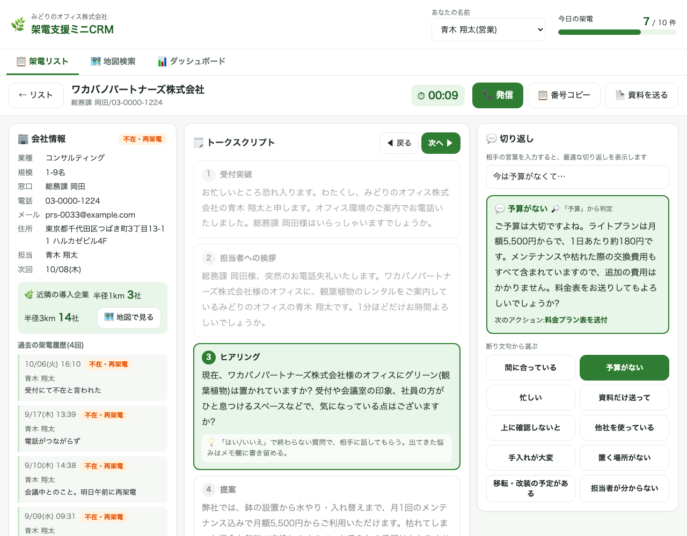
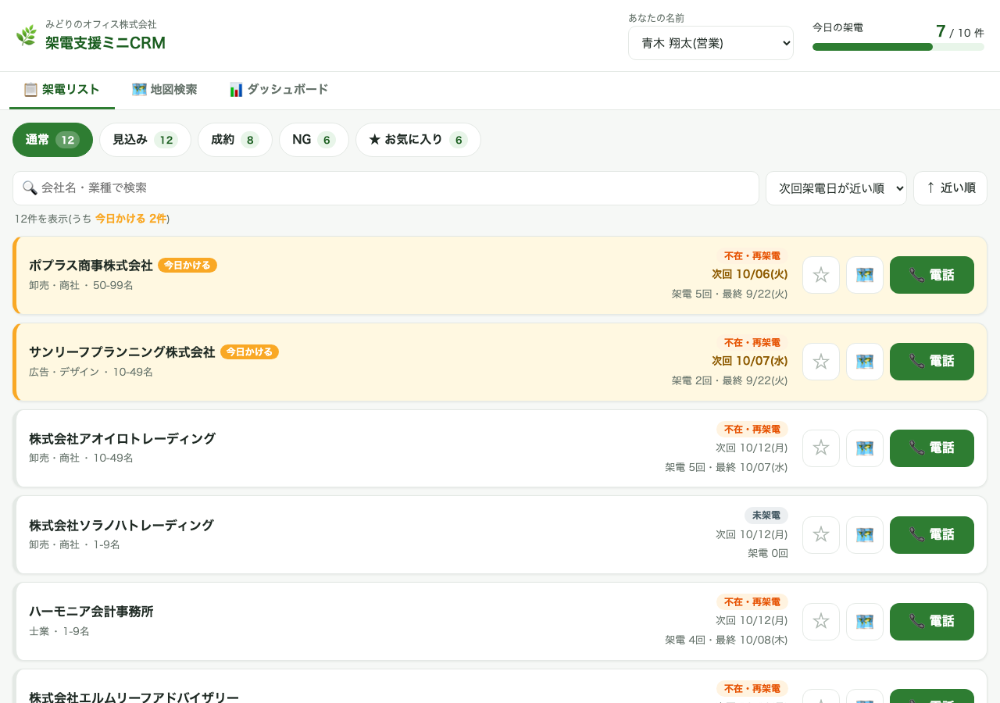
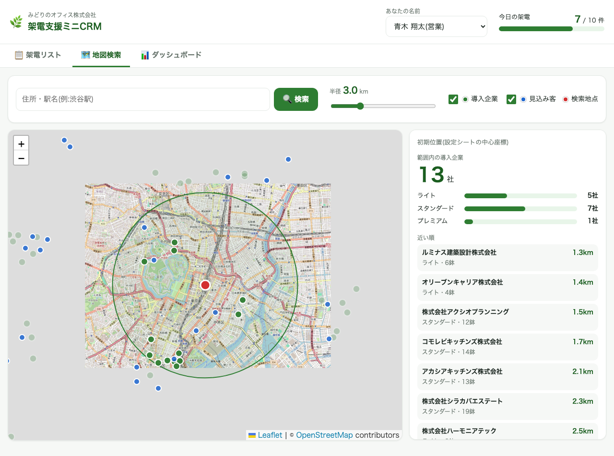
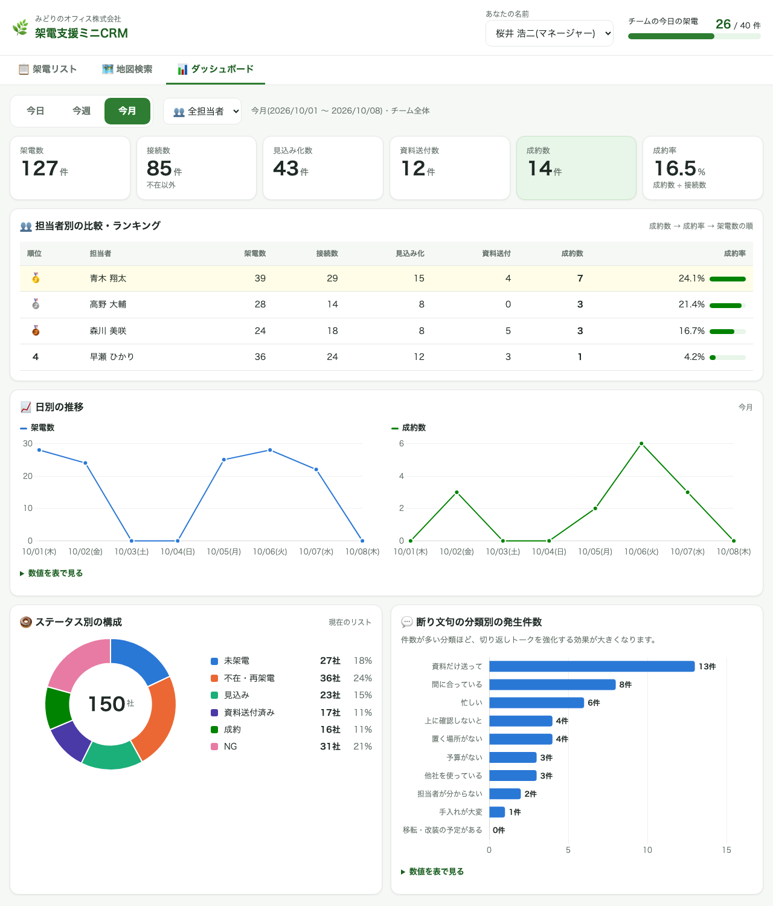

# 架電支援ミニCRM(みどりのオフィス株式会社・デモ)

法人向け観葉植物レンタルの営業チーム(営業4名+マネージャー1名)を想定した、**架電リスト管理と電話営業の支援ツール**です。
Google スプレッドシートと Google Apps Script だけで動き、追加の費用はかかりません。

> ⚠️ ポートフォリオ用のデモです。会社名・人名・電話番号・メールアドレス・住所の番地は、すべて架空のダミーデータです。



---

## 1. ツールの紹介

### 課題
| 現場で起きていたこと | 困りごと |
|---|---|
| 架電リストを Excel で管理 | 誰がどこに電話し、結果がどうだったかがバラバラ |
| 新人が電話中に何を話せばいいか分からない | 断り文句に切り返せず、トークの質が人によって違う |
| 架電後の資料送付が手作業 | 送り忘れが発生する |
| 「この近くで導入している会社はありますか?」 | その場で即答できない |
| 成果の集計が手作業 | マネージャーが担当者ごとの数字をすぐに把握できない |

### 解決
- **リストの自動振り分け**:架電結果を保存すると、ステータスに応じて「通常/見込み/成約/NG」のリストへ自動で移動
- **架電モード**:ワンタップで発信。通話中はトークスクリプトと、断り文句への切り返しを画面に表示
- **ボタン1つで資料送付**:テンプレートに会社名などを差し込んだメールを、PDF付きで Gmail の下書きに保存(または送信)
- **地図で半径検索**:近隣の導入企業数・プラン別の内訳を、その場で回答
- **成果ダッシュボード**:担当者ごとの架電数・成約率・ランキングをリアルタイムに表示

### 効果
- リスト管理と結果入力の手間を削減
- 新人でもトークの質が安定
- 資料の送り忘れゼロ
- 近隣の導入実績を即答でき、説得力のある提案に
- マネージャーの集計作業がゼロに

---

## 2. 機能一覧

| 画面 | 機能 |
|---|---|
| 共通 | 担当者の選択(ブラウザに保存)/今日の架電数と目標の進捗バー/読み込み表示・二重押し防止/成功・失敗のトースト通知 |
| 架電リスト | サブタブ(通常・見込み・成約・NG・お気に入り)と件数バッジ/自分の担当分のみ表示(マネージャーは担当者で絞り込み)/会社名・業種で検索/並び替え(次回架電日・架電回数・最終架電日)/次回架電日が今日以前なら「今日かける」と強調/お気に入り/地図で見る |
| 架電モード | tel: リンクで発信(PCでは番号コピー)/通話タイマー/会社情報・過去の架電履歴・メモ/**近隣の導入企業数(半径1km・3km)**/トークスクリプト(「次へ」で強調と自動スクロール、会社名などを差し込み)/切り返し(分類ボタン、相手の言葉からの自動判定) |
| 架電結果 | ステータスを大きなボタンで選択/次回架電日(不在・再架電と見込みは必須、初期値は自動で入力)/通話メモ/使用した切り返し/保存時は LockService で排他制御/「次の架電先へ」 |
| 資料送付 | 3種類の資料(PDF)から選択/差し込み済みメールのプレビューと編集/「Gmailの下書きに保存」(初期値)・「今すぐ送信」(宛先が example.com のときは実行ユーザー自身に送信)/送付後は「資料送付済み」に更新し、履歴に記録 |
| 地図検索 | 住所・駅名の検索(GAS標準のジオコーダー)/半径スライダー 0.5〜10km(円と集計がリアルタイムに変化)/範囲内の導入企業数・プラン別の内訳・近い順の一覧/ピンの表示切り替え(導入企業=緑、見込み客=青、検索地点=赤)/距離はハバーサイン公式で計算 |
| ダッシュボード | 期間切り替え(今日・今週・今月)/指標カード(架電数・接続数・見込み化数・資料送付数・成約数・成約率)/担当者別の比較とランキング(マネージャーのみ)/日別の推移/ステータス別の構成/断り文句の分類別の発生件数 |
| AI(任意) | 切り返しの提案を MOCK(キーワード判定)/ CLAUDE / GEMINI から選べる。失敗時は MOCK に自動で切り替え、ログに記録 |

> FAX送付は実装していませんが、外部FAXサービスとのAPI連携で追加できます。

| 架電リスト | 地図検索 |
|---|---|
|  |  |



### 技術構成
- Google Apps Script(V8)+ HTML Service(Webアプリ)
- Google スプレッドシート(データ保存先)/ Gmail(資料送付)/ Google ドライブ(資料PDF)
- 地図:Leaflet.js + OpenStreetMap、住所変換:`Maps.newGeocoder()`(無料枠)
- グラフ:Chart.js
- 開発:clasp(ローカルで編集し、`clasp push` で反映)

---

## 3. セットアップ手順

### 3-1. 準備(初回のみ)
1. Node.js を入れ、clasp をインストールする
   ```bash
   npm install -g @google/clasp
   ```
2. https://script.google.com/home/usersettings で「Google Apps Script API」をオンにする
3. clasp にログインする
   ```bash
   clasp login
   ```

### 3-2. スプレッドシートとスクリプトの紐付け
1. Google ドライブで新しいスプレッドシートを作る
2. 「拡張機能 → Apps Script」を開き、「⚙ プロジェクトの設定」の**スクリプトID**をコピーする
3. このフォルダに `.clasp.json` を作る(Git には含めません)
   ```json
   {
     "scriptId": "ここにスクリプトID",
     "rootDir": "src"
   }
   ```
4. コードを反映する
   ```bash
   clasp push
   ```

### 3-3. 初期データの作成
1. Apps Script エディタで `setup` を実行する(初回は権限の承認画面が出るので「許可」)
   - シート9つ、担当者5名、トークスクリプト5ステップ、切り返し10パターン、資料PDF 3つ(ドライブの「みどりのオフィス_デモ資料」フォルダ)ができます
2. `generateDummyData` を実行する
   - 見込み客150件・導入企業80件・架電履歴 約600件(過去30日)ができます
3. 以降は、スプレッドシートの「🌿 CRMデモ」メニューからも実行できます(「ダミーデータを削除」で作り直し可能)

> 💡 ダミーデータは作った時刻までの履歴になります。デモ当日の日中(10時以降)に作り直すと、ダッシュボードの「今日」にも数字が入ります。

### 3-4. Webアプリとして公開
- 開発中:「デプロイ → デプロイをテスト」の URL(末尾 `/dev`)。`clasp push` した最新のコードがすぐ反映されます
- 公開用:`clasp create-deployment --description "v1"` または「デプロイ → 新しいデプロイ → ウェブアプリ」。URLの末尾は `/exec` です
  - 初期設定は「実行ユーザー:自分/アクセス:自分のみ」です(`src/appsscript.json`)。他の人にも見せる場合は、Gmail で下書きを作られてもよいかを考えたうえでアクセス範囲を変更してください
  - コードを更新したら `clasp deploy -i <デプロイID>` で公開版にも反映します

### 3-5. スクリプトプロパティ(任意)
「⚙ プロジェクトの設定 → スクリプト プロパティ」で設定します。APIキーはコードに書かず、ここにだけ保存します。

| プロパティ | 内容 |
|---|---|
| `AI_PROVIDER` | `MOCK`(初期値。無料)/ `CLAUDE` / `GEMINI` |
| `ANTHROPIC_API_KEY` | CLAUDE モードで使う Anthropic の APIキー |
| `GEMINI_API_KEY` | GEMINI モードで使う Google AI Studio の APIキー |
| `CLAUDE_MODEL` / `GEMINI_MODEL` | 使うモデル(未設定時は `claude-opus-5-5` / `gemini-3.8-flash`) |
| `SPREADSHEET_ID` | `setup()` が自動で保存(変更不要) |

> Claude API は有料です。Gemini API の無料枠はモデルによって異なります。何も設定しなければ MOCK で動き、費用はかかりません。

---

## 4. 使い方

1. **名前を選ぶ**:画面上部の「あなたの名前」で自分を選ぶ。次回からは自動で選ばれます
2. **今日かける会社から電話**:通常リストは次回架電日が近い順に並び、「今日かける」の会社が上に来ます。「📞 電話」を押すとスマホでは電話アプリが起動し、画面が架電モードに切り替わります
3. **スクリプトに沿って話す**:「次へ ▶」でステップを進めると、今話す部分が強調されます
4. **断られたら切り返す**:相手の言葉を入力欄に打つと、最適な切り返しトークが出ます。分類ボタンから選んでもOK
5. **「近くで導入している会社は?」**:会社情報の「近隣の導入企業 半径1km ○社」を答える。詳しくは「地図で見る」
6. **結果を保存**:ステータスを選び、メモを書いて「💾 結果を保存」。会社は自動で該当のリストへ移動します
7. **資料を送る**:「📄 資料を送る」で資料を選び、内容を確認して「下書きに保存」。ステータスは「資料送付済み」になります
8. **次の会社へ**:「次の架電先へ ▶」で通常リストの次の会社へ
9. **成果を確認**:ダッシュボードで今日・今週・今月の数字を確認。マネージャーは担当者別のランキングも見られます

---

## 5. ディレクトリ構成

```
demo2-sales-crm/
├── CLAUDE.md            # 要件定義書・開発ルール
├── README.md
├── .gitignore           # .clasp.json / .clasprc.json / 秘密情報を除外
├── docs/images/         # README 用の画面写真(ダミーデータ)
└── src/
    ├── appsscript.json   # マニフェスト(タイムゾーン・権限・Webアプリ設定)
    ├── Config.js         # 定数・シート名・列定義・ステータス定義
    ├── Setup.js          # 初期セットアップ・メニュー・ログ出力
    ├── DummyData.js      # ダミーデータの生成・削除
    ├── ListService.js    # 架電リストの取得・更新・排他制御
    ├── CallService.js    # 架電履歴の記録
    ├── ScriptService.js  # トークスクリプト・切り返し・差し込み
    ├── MailService.js    # 資料のメール送付
    ├── MapService.js     # 住所変換・半径検索(ハバーサイン公式)
    ├── DashboardService.js # 成果の集計
    ├── AiService.js      # 切り返しの提案(MOCK / CLAUDE / GEMINI)
    ├── WebApp.js         # doGet と画面から呼ばれる関数
    ├── index.html / css.html / js.html  # 画面
```

### スプレッドシートの構成
見込み客/導入企業/架電履歴/担当者/トークスクリプト/切り返し集/資料/設定/ログ の9シート。
トークスクリプト・切り返し集・メールの文面・1日の架電目標などは、**シートを編集するだけで変更できます**(コードの修正は不要)。

### 仕様メモ
- リスト区分はステータスから自動で決まります(未架電・不在・再架電 → 通常/見込み・資料送付済み → 見込み/成約 → 成約/NG → NG)
- 1回の電話は架電履歴の1行です。結果を保存した後に資料を送った場合は、同じ行を「資料送付済み」に更新します
- 接続数 = 不在・再架電以外の架電、成約率 = 成約数 ÷ 接続数
- エラーはログシートに記録します(2,000行を超えたら古い500行を自動で削除)

---

## 6. 操作動画の台本(約2分)

| 時間 | 画面・操作 | ナレーション |
|---|---|---|
| 0:00〜0:10 | ツール全体(架電リスト) | 「観葉植物レンタルの営業チーム向けに作った、架電支援のミニCRMです。スプレッドシートとGoogle Apps Scriptだけで動きます。」 |
| 0:10〜0:25 | 名前を選ぶ → サブタブ・件数バッジ → 「今日かける」の強調 | 「担当者を選ぶと自分のリストだけが表示されます。今日電話すべき会社は黄色で強調され、上から順にかけるだけです。」 |
| 0:25〜0:40 | 「電話」を押す → 架電モード → 「次へ」でスクリプトを進める | 「電話ボタンを押すと発信と同時に架電モードに切り替わります。会社名が差し込まれたトークスクリプトを、ステップごとに読み進められます。」 |
| 0:40〜0:55 | 入力欄に「予算がなくて」→ 切り返しが表示 → 分類ボタンも押す | 「断られたら、相手の言葉を入力するだけで最適な切り返しが出ます。新人でもトークの質が安定します。AIでの提案にも切り替えられます。」 |
| 0:55〜1:10 | 「見込み」を選んで保存 → リストに戻ると見込みタブへ移動している | 「結果を選んで保存すると、会社は自動で見込みリストへ。次回架電日も自動で入り、管理の手間がかかりません。」 |
| 1:10〜1:25 | 「資料を送る」→ プレビュー → 「下書きに保存」→ Gmail の下書きを見せる | 「資料もボタン1つ。会社名入りのメールにPDFを添付して、Gmailの下書きに保存します。送り忘れがなくなります。」 |
| 1:25〜1:40 | 会社情報の「近隣の導入企業」→ 地図検索で半径スライダーを動かす | 「『近くで導入している会社は?』と聞かれても、半径1kmに何社と即答できます。地図では半径を変えると件数とプラン別の内訳がその場で変わります。」 |
| 1:40〜2:00 | マネージャーに切り替え → ダッシュボード(今月)→ ランキング → 断り文句のグラフ | 「マネージャーは担当者別の成果とランキングをリアルタイムに確認できます。よく出る断り文句も分かるので、どの切り返しを強化すべきかが見えてきます。集計作業はゼロです。」 |

---

## 7. 提案文で使える紹介文

> Googleスプレッドシートだけで動く、電話営業向けのミニCRMを作成しました(追加費用なし)。
> 架電結果に応じたリストの自動振り分け、通話中のトークスクリプトと切り返しの表示、資料メールのワンクリック送付に対応しています。
> 地図で近隣の導入実績を即答でき、担当者別の成果ダッシュボードでマネージャーの集計作業もゼロになります。
